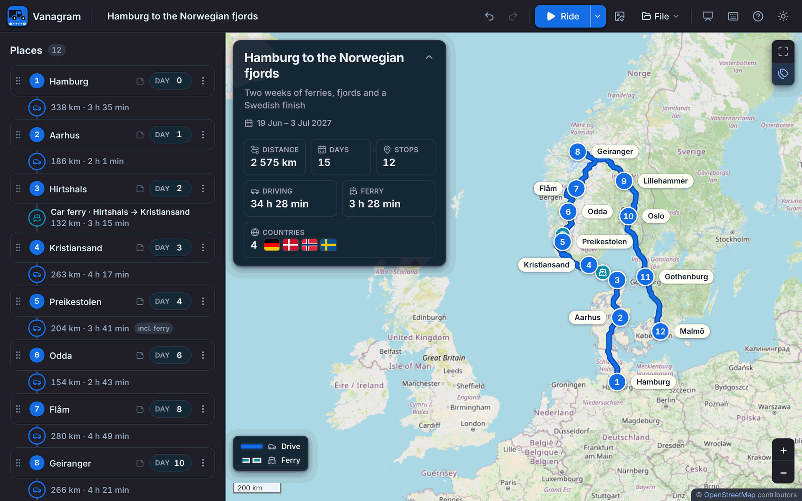
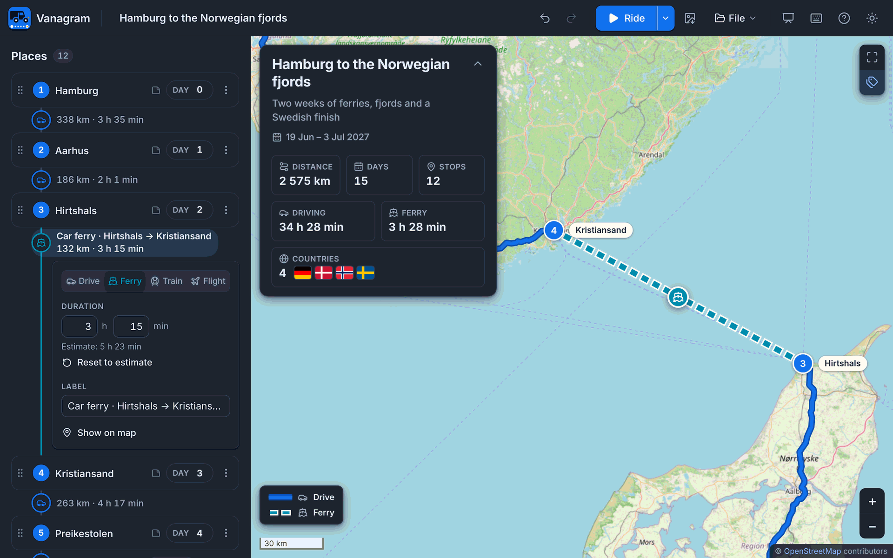
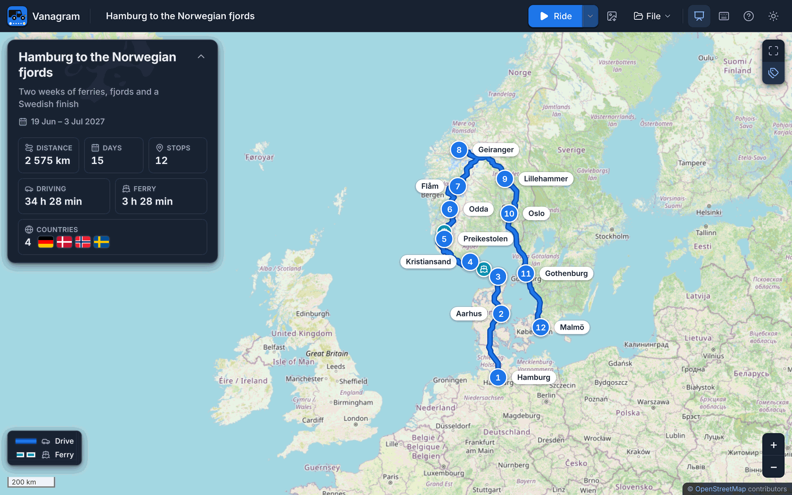
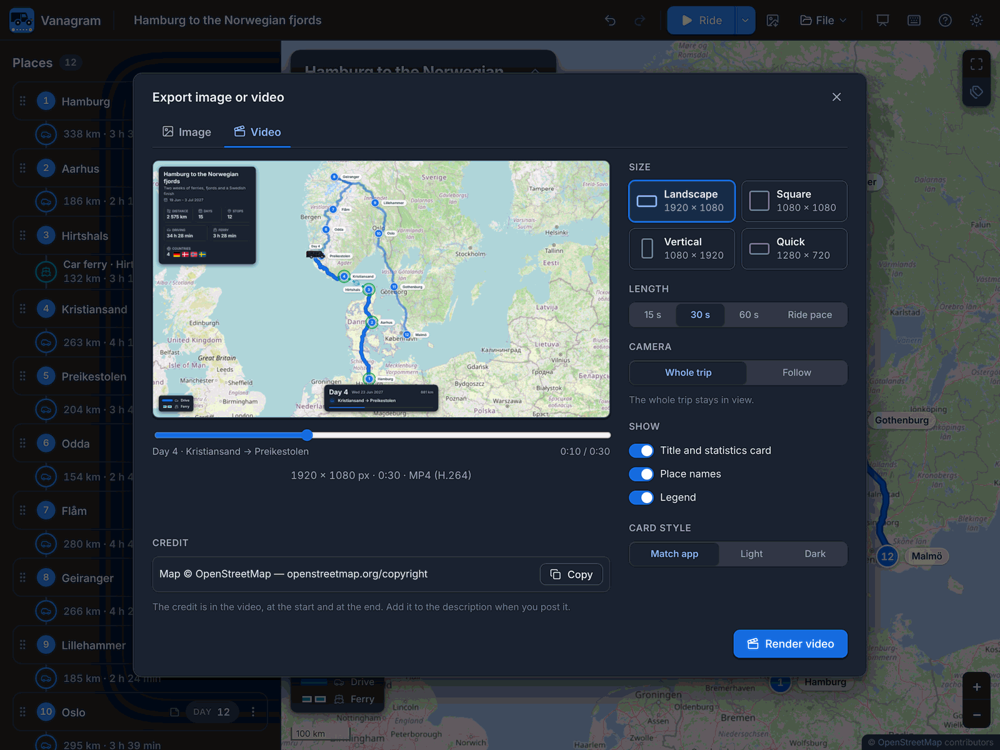

<h1 align="center">
  <picture>
    <source media="(prefers-color-scheme: dark)" srcset="docs/brand/logo-lockup-dark.svg">
    
  </picture>
</h1>

<p align="center"><strong>Your road trip on one map.</strong></p>

<p align="center"><strong>Live site: <a href="https://filipwojcicki.com/vanagram/">https://filipwojcicki.com/vanagram/</a></strong></p>

**Vanagram** is a browser app for sketching a road trip (by car, van, motorbike or anything else with wheels) on an
[OpenStreetMap](https://www.openstreetmap.org/) map. You add the places you stop at, give each a day, and the app draws the route between
them: roads you can reshape by dragging the line (like Google Maps), plus ferry, train and flight legs. A title card shows the distance,
driving time, days and the countries you pass; a little vehicle can *ride* the route day by day; and the trip can be saved as a file, shared
as a link, shown full-screen, or exported as a picture or a video of the ride. Everything runs in your browser: there is no account and no
server of ours, and the trip stays in your browser until you save or share it.

Try it with the bundled sample trip: **File → Load sample trip**.



## Features

### Places

- **Add a place** by typing a name in the *Add a place…* box under the list and pressing Enter (search runs on Enter, never while you type),
  or right-click the map (long-press on a phone) and choose *Add place here*. *Insert place here* puts a place into the route where you clicked.
- **Reorder** places by dragging the grip at the left of a row (or with the keyboard: Space, arrow keys, Space), or move one by dragging its
  marker. The *Day* field of a place is the day of travel on which you reach it: days drive the trip length, the dates and the ride, and
  gaps are rest days.
- **Click a place** to expand it: search for a different location, rename it, or write a **note** (opening hours, what to see, where to
  park), shown on the map when you hover the marker.
- **Photos.** Add several at once or drop image files on a place's *Photos* area. They are shrunk to 2048 px and kept in your browser as JPEG
  without the camera's metadata (GPS included); a place holds up to 50 and a trip up to 300. HEIC works only where the browser can decode it.
- **Click a marker** to open the place's **card**: its day and date, the note and the photos, which open large to flip through (← →).

### Routes

- Legs between places are **routed over roads** ([OSRM](https://project-osrm.org/)) and cached, so undo, redo and re-ordering are instant.
- **Reshape a route** by dragging the line: it bends through the point you drop (a *via point*). The round handle of a via point shows only
  while the pointer is over the line, while you drag, or when it has keyboard focus. Drag a handle to move it, double-click or right-click
  it to remove it; *Reset shape* in the leg editor removes them all.
- **Custom legs.** Click the connector between two places to open the leg editor: switch the leg to **Ferry**, **Train** or **Flight**
  (drawn by hand, flights as great-circle arcs, with a time estimate), turn off **Follow roads** for a straight drive, set the travel time
  yourself and give the leg a label. Car ferries inside a driven route are detected automatically.



### The title card

The card at the top-left of the map shows the trip's title, subtitle and dates (click to edit), the **distance**, **days**, **stops**,
**driving time** (and ferry, train or flight time) and the **countries** you pass with their flags. Fold it into a pill with the chevron.

### Ride

**Ride** plays the trip as your vehicle driving the route day by day (a ferry, train or plane on those legs), with a trail behind it, the
day and date, the distance so far and a scrubber. Space plays or pauses, ← and → jump between days, **Follow** keeps the camera on the
vehicle, Esc closes it. The clapperboard button in the controls opens the [video export](#video-export).

**Choose the vehicle** with the small arrow next to the Ride button: a **Car** (the default), a long **Campervan** (a high-roof van, black
unless you pick a colour), a retro camper bus, a motorhome, a car with a caravan or a 4×4 with a roof tent, each in a colour of your choice.
The vehicle is part of the trip: one undo step, saved in the file and carried by share links. New trips start with the vehicle you chose last.


### Presentation mode

The presentation button in the top bar (or the **P** key) hides the sidebar and every editing tool, so the map, the title card and the ride
fill the window. Esc or the same button leaves it. **File → Copy presentation link** opens a trip straight in this mode ([Sharing](#sharing)).



### Image export

The **Export image** button in the top bar opens a dialog whose *Image* tab renders the whole trip as a **PNG picture**: the map with the
route, numbered stops, the title and statistics card and the legend. Choose a size (landscape 1920 × 1080, portrait, square or A4 print), a
sharper 2× resolution, what to show, and the card style (match the app, light or dark); check the live preview, then **Download PNG** or
**Copy image**. Exporting never changes the trip, so it also works in presentation mode.

The map is © OpenStreetMap contributors, whose licence asks for a credit wherever it is shown, so the credit cannot be switched off. By
default it goes **beside the image**: the dialog offers the caption *Map © OpenStreetMap — openstreetmap.org/copyright* with a Copy button
to post with the picture. Or choose **Small, in the image** to draw it in a corner.


### Video export



The same dialog has a **Video** tab (the clapperboard button in the ride's controls opens it there) that renders the ride as a **video**:
the trail the vehicle leaves, the stops turning green as they are reached, and a panel with the day, the date, the distance so far and where
it is going. Choose a size (landscape, square, vertical for stories and reels, or a quick 720p), a length (15, 30 or 60 seconds, or the
live ride's own pace) and a camera (the whole trip, or following the vehicle), and look at any moment of it with the slider before you
render. **Render video** shows its progress and can be cancelled; then play the video, **Download** it or **Share** it where the browser can
share files. It is made in your browser, faster than real time, as an MP4 where the browser can encode one (Chrome, Edge, Safari) and as a
WebM elsewhere; keep the tab open while it renders.

The video carries its own OpenStreetMap credit (in a corner for the first five seconds and on the closing shot), which cannot be switched
off; the dialog also offers the caption to add to the description when you post it.

### Saving, light and dark, a quiet sea

- Your trip is **saved in this browser automatically** and comes back when you reopen the page; with the page open in two tabs, the second
  asks whether to load a trip the first saved or keep its own. Files and links are covered in [Sharing](#sharing).
- The theme follows your system and can be switched with the moon/sun button; the map tiles keep the standard OpenStreetMap style.
- That style draws country and maritime borders and marine protected areas right across the sea, which only distracts from a trip.
  Vanagram recolours them to the colour of the water, on the map and in exported images; coastlines, land borders, ferry lines and names
  stay. This works on the standard OpenStreetMap tiles only.

### Help and keyboard shortcuts

The **?** button (or the `?` key) opens a help dialog with short how-tos and **every keyboard shortcut**; a first visit with an empty trip
also shows a small dismissible hint. In windows 768 px wide or more on a computer with a mouse or trackpad, a **keyboard button** next to it
in the top bar shows the shortcuts in a popover at a glance: hover it, or click it, or focus it and press Enter (Esc closes it). On phones,
tablets and other touch screens the button is not there, and Help always has the full list.

On phones undo, redo, presentation mode, help and the theme are in the **⋯** menu, and the places list is a slide-over.

## Sharing

- **JSON file**: *File → Save as JSON* (`Ctrl+S`) downloads it; *File → Open trip file…* (`Ctrl+O`) or dropping it on the page opens it. It
  carries the routes and the photos: the safest way to share a long trip, and the only way to share photos.
- **Share link**: *File → Copy share link* puts the whole trip, without its routes and photos, compressed into the address
  (`https://…/#trip=<data>`); whoever opens it gets the trip, and the routes are computed again. Chat apps may cut very long links (over
  about 8 000 characters); the app says so.
- **Presentation link**: *File → Copy presentation link* is the same with `&present` appended; `?present` does it for the trip already in the
  browser. **`?src=<url>`** opens a trip file from a web address (`?src=https://example.org/my.trip.json`; the server must allow CORS).

Whatever a link or file *replaces* is not lost: the previous trip goes to **File → Recent trips…** (the last five).

## The trip file

A trip is saved as a JSON file (`*.trip.json`), documented in [`src/types/trip.ts`](src/types/trip.ts):

```jsonc
{
  "format": "roadmap-overview/trip",
  "version": 1,
  "trip": {
    "title": "Hamburg to the Norwegian fjords",
    "startDate": "2027-06-19",
    "vehicle": { "kind": "iveco-daily" },
    "places": [{ "id": "p1", "name": "Hamburg", "lat": 53.5511, "lng": 9.9937, "day": 0, "note": "Pick up the van…" } /* … */],
    "legs": [{ "id": "l1", "fromId": "p3", "toId": "p4", "mode": "ferry", "via": [], "durationMin": 195, "label": "Car ferry" } /* … */]
  },
  "routes": { "<leg id>": { "key": "…", "geometry": "<encoded polyline>", "distanceM": 338306, "durationS": 12885, "source": "osrm" } }
}
```

- **What it holds.** `trip` is what you edit: places with their days and notes, the legs between them (mode, via points, duration, label)
  and the vehicle. `routes` is an optional cache of the road geometry; a file without it opens fine and is routed on arrival. `legs[i]` joins
  `places[i]` to `places[i + 1]`, and days are whole numbers ≥ 0.
- **Photos** (optional): a file saved with *Save as JSON* also has a top-level `photos` object with the full-size JPEGs, base64-encoded
  (roughly 0.5 MB each). Opening the file stores them in the browser again.
- **`vehicle`** (optional): a `kind` (`campervan` is the **Car** in the picker and what a missing `vehicle` means; `iveco-daily` is the
  **Campervan**; then `retro-bus`, `motorhome`, `caravan`, `offroad`) and an optional body `color` as `#rrggbb`.
- **Compatibility.** `format` is `roadmap-overview/trip`, the name the app had before it was called Vanagram; it stays in every file and
  link, so those made at any time keep opening. `version` (currently `1`) only changes for something older files cannot satisfy, and a file
  from a newer version is refused with a message.
- **Opening is forgiving**: invalid places are dropped, bad days rounded, unknown modes become `drive`, each repair is reported in a toast.
  A trip may have up to 500 places.

## Privacy

Vanagram has no account, no analytics and no server of ours. Your trip, its photos and your settings live in your browser, and nothing
leaves it unless you save a file or copy a link (a share link holds the trip after the `#` in the address, which browsers do not send to
any server). To work, the page asks the public services below for map tiles (the area you look at), road routes (the coordinates of your
places) and place search (the text you search for, and the coordinates of a pin you drop).

## Data sources and credits

Vanagram calls three public, community-run services directly from the browser. They are free and shared: please keep it that way.

| Service | Used for | Policy and what the app does |
| --- | --- | --- |
| **OpenStreetMap tiles**, `tile.openstreetmap.org` | The map, the exported image and video | Map data © [OpenStreetMap contributors](https://www.openstreetmap.org/copyright), ODbL. The [tile usage policy](https://operations.osmfoundation.org/policies/tiles/) asks for visible attribution (always shown on the map; an exported image carries it in a corner or beside it, as the [attribution guidelines](https://osmfoundation.org/wiki/Licence/Attribution_Guidelines) require, and a video in the picture), no bulk downloading and no heavy use. The app fetches only the tiles of what you look at or export (at most 300 for an image or a video, six at a time) and keeps them in memory. |
| **OSRM demo server**, `router.project-osrm.org` | Road routes between places | [Demo server policy](https://github.com/Project-OSRM/osrm-backend/wiki/Demo-server): light use only, no guarantees. The app sends at most one request at a time and one per second, never repeats a request (routes are cached and saved with the trip) and does not retry in a loop: a failed leg shows a *Retry* button. For regular use run your own [OSRM](https://github.com/Project-OSRM/osrm-backend). |
| **Nominatim**, `nominatim.openstreetmap.org` | Place search and naming dropped pins | [Usage policy](https://operations.osmfoundation.org/policies/nominatim/): at most one request per second, no search-as-you-type, cache results, identify the application. The app searches only on Enter or the search button, queues requests one per second, caches answers and sends the browser's own `Referer`. |

A trip file, a share link and the sample trip need none of these to *open*; only editing a route or searching does. Country boundaries and
flags are bundled with the app.

Vanagram is built on open-source software. The ones whose licences ask for a mention:

- [Leaflet](https://leafletjs.com/) (BSD-2-Clause) and [React-Leaflet](https://react-leaflet.js.org/) (Hippocratic License 2.1) draw the map;
  [Mediabunny](https://mediabunny.dev/) (MPL-2.0) puts the encoded frames in an MP4 or WebM file.
- [Inter](https://rsms.me/inter/) (SIL Open Font License 1.1) is the typeface of the app and of the logo's lettering; its licence is in
  [`docs/brand/LICENSE-Inter.txt`](docs/brand/LICENSE-Inter.txt).
- [world-atlas](https://github.com/topojson/world-atlas) (ISC) carries the [Natural Earth](https://www.naturalearthdata.com/) country
  boundaries (public domain); [flag-icons](https://github.com/lipis/flag-icons) (MIT) the flags; [Lucide](https://lucide.dev/) (ISC) the icons.
  The other dependencies in [`package.json`](package.json) are under permissive licences (MIT, ISC or BSD).

## Development

You need [Node.js](https://nodejs.org/) 20.19 or newer (22 recommended).

```sh
git clone https://github.com/Fiwo735/vanagram.git
cd vanagram
npm ci                  # install
npm run dev             # dev server at http://localhost:5173
npm run typecheck       # tsc -b (app, tooling and tests)
npm run lint            # oxlint
npm test                # Vitest: the pure logic and the tooling
npm run e2e             # Playwright: the whole UI against mocked tile, routing and search servers
```

- `npm run dev -- --port 5300` and `E2E_PORT=5300 npm run e2e` pick another port. The e2e specs mock OSM tiles, OSRM and Nominatim and fail
  any other external request; `E2E_REAL_NETWORK=1` turns the mocks off (use it sparingly: the services are shared).
- The service addresses are constants in [`src/services/config.ts`](src/services/config.ts). In dev builds `window.__ROADMAP__` exposes the
  stores and the Leaflet map, and a component gallery is served at `/ui-kit.html`.
- Built with Vite, React, TypeScript, Leaflet, Zustand, dnd-kit and a handful of small libraries.
  **[ARCHITECTURE.md](ARCHITECTURE.md)** describes the structure and keeps a log of every feature with its decisions and known gaps: read it
  before changing anything.
