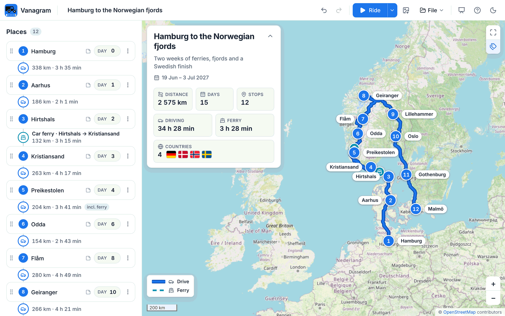
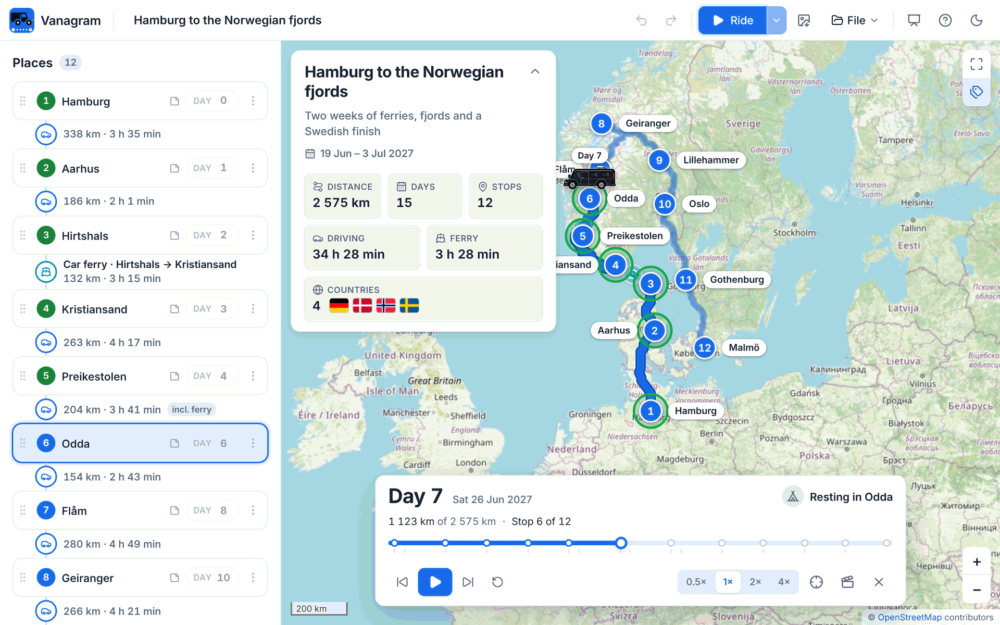
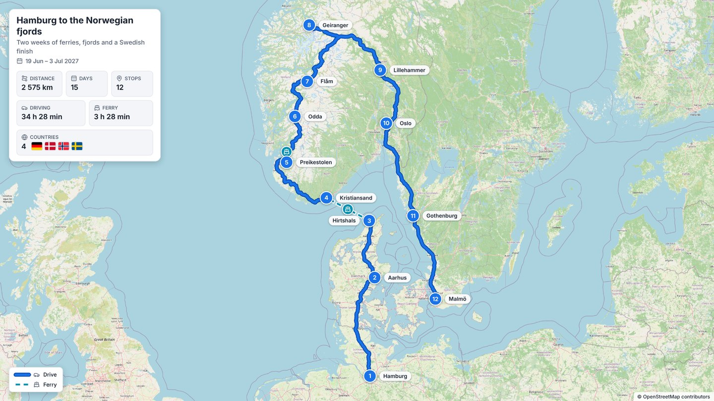
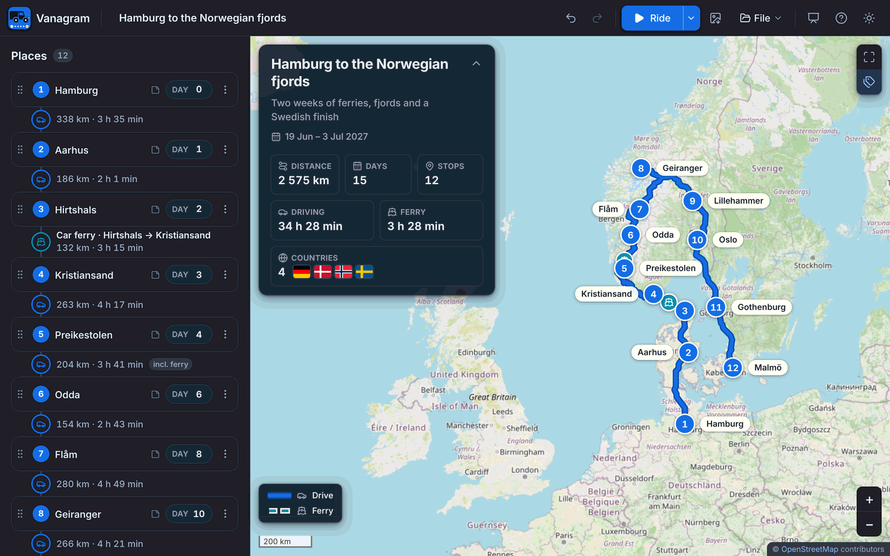

<h1 align="center">
  <picture>
    <source media="(prefers-color-scheme: dark)" srcset="docs/brand/logo-lockup-dark.svg">
    
  </picture>
</h1>

<p align="center"><strong>Your campervan trip on one map.</strong></p>



**Vanagram** is a browser app for summarising a campervan trip on an [OpenStreetMap](https://www.openstreetmap.org/) map. You
add the places you stop at, give each a day, and the app draws the route between them: roads you can reshape by dragging the line (like
Google Maps), plus ferry, train and flight legs drawn by hand. A title card shows the distance, driving time, days and the countries you
pass; a little vehicle can *ride* the route day by day; and the trip can be saved as a file, shared as a link, shown full-screen or
exported as a picture or a video of the ride. Everything runs in the browser: there is no backend and no account, and the trip stays in your browser until you
save or share it.

**Live site: <https://fiwo735.github.io/roadmap-overview/>** (published from this repository, see [Deployment](#deployment)).
Try it with the bundled sample trip: **File → Load sample trip**.

## Contents

- [Features](#features)
- [Keyboard shortcuts](#keyboard-shortcuts)
- [The trip file](#the-trip-file)
- [Sharing](#sharing)
- [Development](#development)
- [External services](#external-services)
- [Hosting](#hosting)
- [Deployment](#deployment)
- [Name, logo and link previews](#name-logo-and-link-previews)

## Features

### Places

- **Add a place** by typing a name in the *Add a place…* box under the list and pressing Enter (search runs on Enter, never while you type),
  or right-click the map (long-press on a phone) and choose *Add place here*. *Insert place here* puts a place into the route where you
  clicked.
- **Reorder** places by dragging the grip at the left of a row (or with the keyboard: Space on the grip, arrow keys, Space). Drag a marker on
  the map to move a place; its name is looked up again.
- **Days.** The *Day* field of a place is the day of travel on which you reach it. Days drive the trip length, the dates and the ride;
  leave gaps for rest days.
- **Click a place** to expand it: search for a different location, rename it, or write a **note** (opening hours, what to see, where to
  park). A note shows as a small icon on its row and in the label on the map while you hover the marker.
- **Photos.** The expanded row has a *Photos* area: *Add photos* (several at once) or drop image files on it. Photos are shrunk to at most
  2048 px and stored as JPEG in your browser (IndexedDB; the camera's metadata, GPS included, is not kept); a place holds up to 50 and a
  trip up to 300. Select a thumbnail to caption it or change its order, × removes it; every change is one undo step. The row shows the
  number of photos. HEIC pictures work only where the browser can decode them (Safari); elsewhere convert them to JPEG first.
- **Click a marker** on the map to open the place's **card**: its day and date, the note and the photo thumbnails, anchored to the marker.
  Click a thumbnail to see the photo large and flip through the others (← → or swipe, Esc closes). Photos show nowhere else on the map, and
  the card also works in presentation mode. (It does not open during a ride.)

### Routes

- Legs between places are **routed over roads** ([OSRM](https://project-osrm.org/)) and cached, so undo, redo and re-ordering are instant.
- **Reshape a route** by dragging the line: it bends through the point you drop (a *via point*). The line stays plain: the round
  handle of a via point only shows while the pointer is over the leg's line (or the handle), while you drag, or when a handle has keyboard
  focus; on a touch screen the selected leg shows them. Drag a handle to move its via point, double-click or right-click it to remove
  it. *Reset shape* in the leg editor removes them all. A via point that lands on a dead-end side road does not leave a stub in the line
  (the short out-and-back is cut out, up to 1 km each way).
- **Custom legs.** Click the connector between two places to open the leg editor: switch the leg to **Ferry**, **Train** or **Flight**
  (drawn by hand, flights as great-circle arcs, with a time estimate), turn off **Follow roads** for a straight drive, set the travel
  time yourself and give the leg a label. Car ferries inside a driven route are detected automatically.


### The title card

The card at the top-left of the map shows the trip's title, subtitle and dates (click to edit) and the **distance**, **days**, **stops**,
**driving time** (and ferry, train or flight time), and the **countries** you pass with their flags. Travel times are always written in
hours ("34 h 28 min"). Fold the card into a pill with the chevron.

### Ride

**Ride** plays the trip as your vehicle (a car unless you choose another) driving the route day by day (a ferry, train or plane on those legs), with a trail behind it, the
day and date, the distance so far and a scrubber. Space plays or pauses, ← and → jump between days, **Follow** keeps the camera on the
vehicle, Esc closes it. The clapperboard button in the controls, **Record video**, opens the [video export](#video-export).

**Choose the vehicle** with the small arrow next to the Ride button: a **Car** (the default), a long **Campervan** (a high-roof van with a long rear overhang, black unless you pick
a colour), a retro camper bus, a motorhome, a car with a caravan or a 4×4 with a roof tent. Each has a few body colours and a free choice. The
vehicle is part of the trip, so it is one undo step, is saved in the file and travels in share links; ferries, trains and planes keep their
own pictures. New trips (File → New trip, a first visit, the sample trip) start with the vehicle you chose last; a file or link keeps its own.
It cannot be changed while a ride runs or in presentation mode.



### Presentation mode

The presentation button in the top bar (or the **P** key) hides the sidebar and every editing tool, so the map, the title card and the
ride fill the window: handy for showing a trip to others. Esc or the same button leaves it. **File → Copy presentation link** makes a link
that opens a trip straight in this mode (see [Sharing](#sharing)).


### Image export

The **Export image** button in the top bar (the picture icon) opens a dialog whose *Image* tab renders the whole trip as a **PNG picture**: the map with
the route, numbered stops, the title and statistics card and the legend. Choose a size (landscape
1920 × 1080, portrait, square, or A4 print), a sharper 2× resolution, what to show (card, place names, day numbers, legend), the card
style (match the app, light or dark) and where the **map credit** goes, check the live preview, then **Download PNG** or **Copy image**.
Exporting never changes the trip, so it also works in presentation mode.

**The OpenStreetMap credit.** The map data is © OpenStreetMap contributors and its licence asks for a credit wherever the map is shown.
By default the picture stays clean and the credit goes **beside the image**: the dialog shows the caption *Map © OpenStreetMap —
openstreetmap.org/copyright* with a Copy button, and after a download a note reminds you to add it where you post the image (**Copy image**
copies the picture alone, so pasting it always gives the picture). Choose **Small, in the image** to have the
credit drawn in a corner of the picture instead: small, discreet text with a soft halo, no box. Either way the PNG file itself carries
"Copyright: Map © OpenStreetMap - openstreetmap.org/copyright" in its metadata. The credit cannot be switched off: the
[OSMF attribution guidelines](https://osmfoundation.org/wiki/Licence/Attribution_Guidelines) allow it to leave the image only if it is
printed beside it, with the address openstreetmap.org/copyright.



### Video export


The same dialog has a **Video** tab (the clapperboard button in the ride's controls opens it there) that renders the ride as a **video**:
the planned route faint under the trail the vehicle leaves, the stops turning green as they are reached, the vehicle on the road and the
ferry, train or plane on those legs, and a panel with the day, the date, the distance so far and where it is going. The video opens with a
second on the start and ends with a few seconds on the finished trip.

- **Size:** Landscape 1920 × 1080, Square 1080 × 1080, Vertical 1080 × 1920 (stories and reels) or a quick 1280 × 720. 30 frames a second, no sound.
- **Length:** 15, 30 or 60 seconds, or *Ride pace*, the speed of the live ride (never more than two minutes, however long the trip).
- **Camera:** *Whole trip* keeps the whole trip in view; *Follow* follows the vehicle at a closer zoom, smoothly, and shows the whole trip at
  the start and the end. A trip that is too small to zoom into, or whose map would need more than the tile limit (300 tiles) to be followed at a closer zoom, is shown whole instead, and the dialog says why.
- Title card, place names and legend can be switched off, and the card style is the same Match app / Light / Dark as for the image. A slider
  under the preview shows any moment of the video before you render it. Your choices are remembered.

**Render video** shows a progress bar and the time left, and **Cancel** stops it; nothing is kept. When it is done, play it in the dialog,
**Download video** (`<trip title>-ride.mp4`, or `.webm`) or **Share** it, where the browser can share files (phones). The video is made in
the browser with WebCodecs, faster than real time: an H.264 MP4 where the browser can encode one (Chrome, Edge, Safari), else a VP9/VP8
WebM. A browser without WebCodecs records the picture as it is drawn instead, which takes as long as the video does, so keep the tab in front.

**The OpenStreetMap credit in a video.** The attribution guidelines let a video give its credit in the end credits or the description only
when the map is *not* the focus; here it is, so the credit is **in the video**: "© OpenStreetMap · openstreetmap.org/copyright" in a corner
for the first five seconds and again on the closing shot. Add *Map © OpenStreetMap — openstreetmap.org/copyright* (shown in the dialog,
with a Copy button) to the description when you post it. It cannot be switched off.

### Saving, loading, sharing

Your trip is **saved in this browser automatically** and comes back when you reopen the page. Open the same page in two tabs and the second
one asks, when the first saves a different trip, whether to load it or keep its own. See [Sharing](#sharing) for files and links.

### Light and dark

The theme follows your system and can be switched with the moon/sun button; the map tiles always keep the standard OpenStreetMap style.

### A quiet sea

The standard OpenStreetMap style draws country and maritime borders and the outlines of marine protected areas right across the sea, which
only distracts from a trip. The app recolours them to the colour of the water, on the map and in exported images. Coastlines, land borders,
ferry lines, names and everything else stay as they are. It is done on the tile pictures themselves
([`src/lib/seaOutlines.ts`](src/lib/seaOutlines.ts)), so it needs no other tile provider, and it only knows the standard style's colours: with
another tile server (`TILE_URL`) nothing is hidden.



### Help

The **?** button (or the `?` key) opens a help dialog with short how-tos and every keyboard shortcut. A first visit with an empty trip
also shows a small dismissible hint.

On phones the top bar keeps the title, Ride, Export image or video and File; undo, redo, presentation mode, help and the theme are in the **⋯** menu, and
the places list is a slide-over from the button at the top-left.

## Keyboard shortcuts

`Ctrl` is `⌘` on a Mac. Letters and `?` are ignored while you type in a field, a menu is open or a dialog is shown.

| Keys | Does |
| --- | --- |
| `?` | Open the help |
| `P` | Presentation mode on or off |
| `Esc` | Close a menu, dialog or editor; leave presentation mode; close the ride |
| `Ctrl`+`Z` | Undo |
| `Ctrl`+`Shift`+`Z` or `Ctrl`+`Y` | Redo |
| `Ctrl`+`S` | Save the trip as a JSON file |
| `Ctrl`+`O` | Open a trip file |
| `Enter` | In a search box: search. In the name, day or note fields: save what you typed |
| `↑` `↓` | In search results: pick one. In the day field: one day earlier or later |
| `Esc` | In a field: undo what you typed and leave it |
| `Space`, `↑` `↓`, `Space` / `Esc` | On a row's grip: pick the place up, move it, drop it / put it back |
| `Delete` | On a focused route handle: remove it |
| `Esc` | While dragging a route line: cancel the reshape |
| `Enter` | On a focused marker: open the place card |
| `Esc` | Close the photo viewer, then the place card |
| `←` `→` | In the photo viewer: previous or next photo |
| `←` `↑` `→` `↓`, `+` `-` | Pan and zoom the map (when it has the focus) |
| `Space` | Ride: play or pause |
| `←` `→` | Ride: previous or next day |
| `↑` `↓` `Home` `End` `Enter` | In menus: move, jump, choose; letters jump to an item |

## The trip file

A trip is saved as a JSON file (`*.trip.json`). The format is the **data contract** of the app and is documented in
[`src/types/trip.ts`](src/types/trip.ts):

```jsonc
{
  "format": "roadmap-overview/trip",   // the app's first name, kept: see below
  "version": 1,
  "exportedAt": "2026-11-23T20:56:28.314Z",
  "trip": {
    "id": "t_h7196f0ioy",
    "title": "Hamburg to the Norwegian fjords",
    "subtitle": "Two weeks of ferries, fjords and a Swedish finish",
    "startDate": "2027-06-19",
    "vehicle": { "kind": "iveco-daily" },
    "places": [
      { "id": "p_84ert1k1ms", "name": "Hamburg", "lat": 53.5511, "lng": 9.9937, "day": 0, "note": "Pick up the van…" }
      // …
    ],
    "legs": [
      { "id": "l_cz9a9k6ek4", "fromId": "p_pcs74crom2", "toId": "p_g37z1hltf7", "mode": "ferry", "via": [], "durationMin": 195, "label": "Car ferry" }
      // legs[i] joins places[i] → places[i + 1]
    ]
  },
  "routes": { "<leg id>": { "key": "…", "geometry": "<encoded polyline>", "distanceM": 338306, "durationS": 12885, "source": "osrm" } }
}
```

- **Photos** (optional, no version bump): `place.photos` lists `{ id, width, height, caption? }` references; a file saved with
  *Save as JSON* also has a top-level `photos` object, `{ "<id>": { "mime": "image/jpeg", "data": "<base64>", "width": …, "height": … } }`,
  with the full-size JPEGs. Opening the file stores them in the browser (thumbnails are made again). Files with photos are big (roughly
  0.5 MB per photo). Autosave, recent trips and share links keep only the references, and links drop even those.
- **Intent and derived data are kept apart.** `trip` is what you edit (places, legs, via points, days, notes). `routes` is an optional
  cache of the road geometry, keyed by leg id; the app only trusts a cached route whose `key` matches the trip, otherwise it routes the leg
  again. A file without `routes` opens fine and is routed on arrival.
- **`format`** is `roadmap-overview/trip`, the name the app had before it was called Vanagram. It is written in every file and link made so
  far, so it never changes with the name: a file from before the rename opens as it always did. (The same goes for the `roadmap-overview:…`
  keys the browser storage and the `roadmap-overview` photo database use.)
- **Days** are integers ≥ 0 on which a place is reached; they may be typed out of order (the app uses the running maximum).
- **`vehicle`** (optional) is what the ride drives on roads: `kind` is one of `campervan` (the **Car** in the picker, and what a
  missing `vehicle` means), `iveco-daily` (the **Campervan** in the picker, black unless coloured), `retro-bus`, `motorhome`,
  `caravan` or `offroad`, and `color` is an optional body colour as `#rrggbb`. The kind ids are stored in files and links, so they
  keep their names even where the picker's labels differ.
- **Versioning.** `version` is the file format version (currently `1`). Additive, optional fields do not bump it; a change that older
  files cannot satisfy does, together with a migration in `src/lib/tripFile.ts`. A file with a *newer* version is refused with a message.
- **Opening is forgiving**: invalid places are dropped, bad days rounded, unknown modes become `drive` and every repair is reported in a
  toast; only data that cannot be a trip is rejected. A trip may have up to 500 places.

## Sharing

- **JSON file**: *File → Save as JSON* (`Ctrl+S`) downloads it, *File → Open trip file…* (`Ctrl+O`) or dropping the file on the page opens
  it. The file carries the routes and the photos, so it opens instantly. This is the safest way to share a long trip, and the only way to
  share photos.
- **Share link**: *File → Copy share link* puts the whole trip, without its routes, compressed into the address
  (`https://…/#trip=<data>`); whoever opens it gets the trip (and the routes are computed again). Very long links (over about 8 000
  characters) may be cut off by chat apps, and the app says so. **Links do not carry photos**: the toast says so, and the JSON file does.
- **Presentation link**: *File → Copy presentation link* is the same with `&present` appended: it opens in presentation mode, with no
  editing tools. `?present` in the address does the same for the trip already in the browser, and `?src=…&present` for a trip file.
- **`?src=<url>`**: opens a trip file from a web address, for example one published as a GitHub gist or next to the app
  (`https://…/?src=https://example.org/my.trip.json`, or relative to the page: `?src=samples/my.trip.json`). The server has to allow
  cross-origin reads (CORS); only `http` and `https` are fetched.

Whatever a link or file *replaces* is not lost: the previous trip goes to **File → Recent trips…** (the last five).

## Development

You need [Node.js](https://nodejs.org/) 20.19 or newer (22 recommended).

```sh
npm ci                  # install
npm run dev             # dev server at http://localhost:5173 (npm run dev -- --port 5300 for another port)
npm run typecheck       # tsc -b (app, tooling and tests)
npm run lint            # oxlint
npm test                # Vitest: the pure logic (src/**/*.test.ts) and the build helpers (tools/**/*.test.ts)
npm run e2e             # Playwright: the whole UI against mocked tile/routing/search servers (E2E_PORT=5300 to pick a port)
npm run build           # type-check and build into dist/
npm run preview         # serve dist/
```

- The e2e specs never touch the public servers: `e2e/fixtures.ts` mocks OSM tiles, OSRM and Nominatim and fails any other external
  request. `E2E_REAL_NETWORK=1 npm run e2e` turns the mocks off (use it sparingly, see below). One spec builds the app for a sub-path and
  checks it works there.
- In dev builds `window.__ROADMAP__` exposes the stores and the Leaflet map for tests and for poking around in the console; a component
  gallery is served at `/ui-kit.html`.
- **[ARCHITECTURE.md](ARCHITECTURE.md)** describes the structure (stores, map layers, routing, the data model) and keeps a log of every
  feature with its decisions and known gaps: read it before changing anything.

Built with Vite, React, TypeScript, Leaflet, Zustand (with undo/redo), dnd-kit and a handful of small libraries (the video export adds
[Mediabunny](https://mediabunny.dev/), MPL-2.0, to put the encoded frames in an MP4 or WebM file); see the table in ARCHITECTURE.md.

## External services

The app calls three public, community-run services directly from the browser. They are free and shared: please keep it that way. Their
base URLs are constants in [`src/services/config.ts`](src/services/config.ts), so you can point the app at your own instance (or another
tile provider) by editing that file and rebuilding.

| Service | Used for | Policy and what the app does |
| --- | --- | --- |
| **OpenStreetMap tiles**, `tile.openstreetmap.org` | The map (and the exported image and video) | [Tile usage policy](https://operations.osmfoundation.org/policies/tiles/): visible attribution (always shown on the map; for an exported image either drawn in it or, by default, as a caption beside it that includes openstreetmap.org/copyright, as the [attribution guidelines](https://osmfoundation.org/wiki/Licence/Attribution_Guidelines) require), no bulk downloading (an image or a video export fetches only the tiles of its own picture, at most 300 and six at a time, and keeps them in memory; a video draws its map once and crops it for every frame, it does not ask for tiles per frame, and its credit is in the video itself), and no heavy use: a busy site should use its own tile server or a commercial provider and change `TILE_URL`. Tiles are downloaded with CORS (the server allows it) so their pixels can be read to hide the borders on the sea; processed tiles are kept in memory (160), so a tile you come back to is neither downloaded nor processed again. |
| **OSRM demo server**, `router.project-osrm.org` | Road routes between places | [Demo server policy](https://github.com/Project-OSRM/osrm-backend/wiki/Demo-server): light use only, no guarantees. The app sends at most one request at a time and one per second, never repeats a request (results are cached and saved with the trip) and does not retry in a loop: a failed leg shows a *Retry* button. For regular use run your own [OSRM](https://github.com/Project-OSRM/osrm-backend) (`OSRM_URL`, driving profile). |
| **Nominatim**, `nominatim.openstreetmap.org` | Place search and naming dropped pins | [Usage policy](https://operations.osmfoundation.org/policies/nominatim/): at most one request per second, no search-as-you-type, cache results, identify the application. The app searches only on Enter or the search button, queues requests one per second, caches answers and sends the browser's own `Referer`. Self-host it or use a geocoding service with a compatible `/search` and `/reverse` API (`NOMINATIM_URL`) for more. |

A trip file, a share link and the sample trip need none of these to *open* (routes travel with a file); only editing a route or searching
does. Country boundaries and flags are bundled with the app. If you host a public copy, make sure its traffic stays within these policies.

## Hosting

Vanagram is a static site: `npm run build` writes everything to `dist/`, which any static file host can serve (no server code, no
client-side routes, so no fallback rules are needed). At the root of a domain nothing needs configuring.

### Under a sub-path (GitHub Pages)

A project site on GitHub Pages lives at `https://<user>.github.io/<repository>/`. Build with that path as the base so every script, style,
flag and sample file is requested from there:

```sh
BASE_PATH=/<repository>/ npm run build      # or: npm run build -- --base=/<repository>/
npx vite preview --base=/<repository>/      # check it locally at http://localhost:4173/<repository>/
```

Share links keep the sub-path, and `?src=` addresses are relative to the page. For a site served from your own domain's root (or a
user page, `https://<user>.github.io/`), leave `BASE_PATH` out. This repository publishes itself that way: see [Deployment](#deployment).

## Deployment

The live site, <https://fiwo735.github.io/roadmap-overview/>, is built and published by a GitHub Actions workflow,
[`.github/workflows/deploy-pages.yml`](.github/workflows/deploy-pages.yml). On every push to the repository's default branch (and when you
start it by hand from the *Actions* tab: *Deploy to GitHub Pages → Run workflow*) it:

1. installs the dependencies (`npm ci`, Node 22) and runs the type check, the linter and the unit tests (`npm test`; the Playwright
   suite is not run in CI);
2. asks GitHub Pages for the site's address (`actions/configure-pages`);
3. builds the app with `BASE_PATH=/<repository>/` (the repository name, so the site works under `…github.io/roadmap-overview/`) and that
   address as `VITE_SITE_URL` (the link preview needs it, see [Name, logo and link previews](#name-logo-and-link-previews)), then checks
   that the build carries the base (and warns, without failing, when the link-preview image is not an absolute URL);
4. uploads `dist/` as the Pages artifact and deploys it with the official `actions/deploy-pages` action to the `github-pages` environment.

A failing check stops the deployment, so the live site is always a build that passed them. Other branches are ignored.

**One-time settings** (the workflow cannot change them; do both before the first run):

- **The repository must be public**, or on a GitHub plan that offers Pages for private repositories (GitHub Pro, Team or Enterprise).
- **Settings → Pages → Build and deployment → Source: GitHub Actions.** Until this is set, the deploy job fails (its log says to ensure GitHub
  Pages is enabled); set it and re-run the workflow.

The workflow takes the base path from the repository's name, so a fork publishes at `https://<user>.github.io/<fork name>/` without
changes. Only a *user page* repository (named `<user>.github.io`, served from the root) needs `BASE_PATH` changed to `/`. To check a
build as GitHub Pages will serve it:

```sh
BASE_PATH=/roadmap-overview/ npm run build
BASE_PATH=/roadmap-overview/ npx vite preview     # http://localhost:4173/roadmap-overview/
```

## Name, logo and link previews

The app is **Vanagram**; it started life as "Roadmap Overview", which is why the repository, the deploy path and a few internal ids still say
`roadmap-overview` (the trip file's `format`, the `roadmap-overview:…` keys the browser storage uses, the `roadmap-overview` photo database
and the `window.__ROADMAP__` debug hook): renaming those would orphan trips people already saved.

- **The logo** is original artwork: a long-roof van on a blue tile, with a dotted route under it. The SVG sources, the generator that
  makes every PNG and the usage notes (colours, sizes, the font licence) are in [`docs/brand/`](docs/brand/README.md). The top bar shows
  `public/favicon.svg` as an image, the same file the browser tab uses: it holds two designs and picks the one that suits the size.
- **Icons** (all in `public/`): `favicon.svg`, `favicon-16.png`, `favicon-32.png`, `apple-touch-icon.png` (iOS home screen), `icon-192.png`,
  `icon-512.png` and `icon-maskable-512.png` (Android and installed apps), listed in `manifest.webmanifest` (name Vanagram, standalone,
  theme colour `#1a73e8`) and wired up in `index.html`. Every URL in the manifest is relative, so they work under a sub-path.
- **Link previews.** `index.html` carries Open Graph and Twitter card tags with `public/og-image.png` (1200 × 630). Link scrapers (chat apps,
  social networks) want an **absolute** image URL, which only the deployment knows, so give the build the site's address:

  ```sh
  VITE_SITE_URL=https://example.com/roadmap-overview BASE_PATH=/roadmap-overview/ npm run build
  ```

  With it, `og:image` and `twitter:image` become `https://example.com/roadmap-overview/og-image.png` and `og:url` is added; without it
  (a local build) they stay paths under the base, which is right for the page itself and wrong only for scrapers. The deploy workflow does
  this by itself: it takes `base_url` from `actions/configure-pages`, which is the address GitHub Pages serves the site at, **the owner's custom
  domain** once one is set (`https://fiwo735.github.io/roadmap-overview/` redirects to it), so the preview keeps working if the domain
  changes. A value that is not an `http(s)` URL fails the build.
